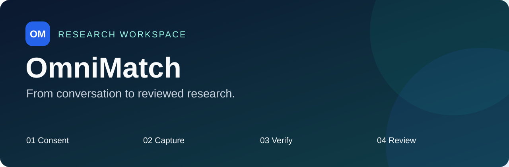
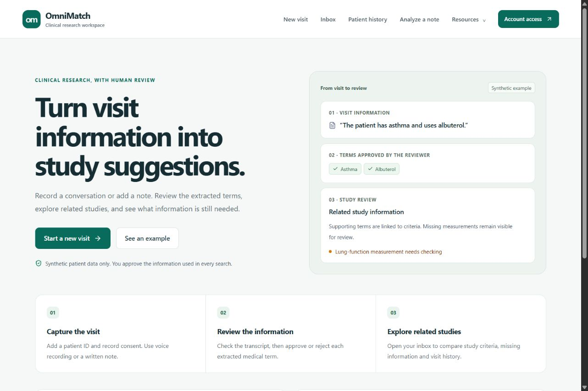

# OmniMatch

**Turn a fictional patient visit into reviewed findings, study suggestions and a clear visit history.**

[Explore the preview](https://omnimatch-research.onrender.com/preview/) · [Install locally](docs/INSTALL_ON_YOUR_COMPUTER.md) · [Models and data](docs/MODELS_AND_DATA.md) · [Documentation](docs/README.md)

## What it does

OmniMatch connects visit capture and clinical-trial research review. Record a fictional conversation or enter a note, check the transcript, approve individual findings, then review possible studies and information still needed.

Built for students, developers and research-workflow evaluators using **synthetic data only**. Suggestions support review; they do not diagnose, prescribe, predict disease or confirm enrollment.

## Features

| Feature | What you can do |
| --- | --- |
| Consent before recording | Enable recording only after consent is logged. |
| Local speech recognition | Transcribe audio with Whisper and correct the words before extraction. |
| Clinical context | Separate patient findings from negation, family history and uncertainty. |
| Human approval | Approve or reject individual terms before matching. |
| Study review | Inspect suggestions, criterion checks and missing information. |
| Visual results | Compare scores and evidence coverage with interactive charts and numerical summaries. |
| Repeat visits | Link visits with a fictional patient label and compare new and repeated terms. |
| Inbox management | Mark reviewed, archive and restore visits while retaining saved records. |
| Optional evidence research | Use local transformers and RAG with cited study excerpts. |
| Approved email access | Use WorkOS email codes and organization permissions instead of shared passwords. |

*Refined interface from the installed app. The workflow illustration uses synthetic information; it does not represent a real patient or study.*

## Choose how to use it

| Option | Link | Includes |
| --- | --- | --- |
| Public website | [omnimatch-research.onrender.com](https://omnimatch-research.onrender.com/) | Preview, policies, model information and installation links. |
| Your local installation | [localhost:3000](http://localhost:3000) | Recording, model processing, protected visits and saved history after setup. |
| Existing development laptop | [localhost:3013/session/](http://localhost:3013/session/) | Alternate port used by the existing development installation. |

**The public site does not host the Python models or visit database.** A localhost link opens an application on your own computer; it is not a public sharing link.

## Quick start

### 1. Install the prerequisites

- Git and Python **3.10 or newer** for the setup helper.
- Docker Desktop with Linux containers on Windows/macOS, or Docker Engine with Compose v2 on Linux. Start Docker before continuing.
- Plan for **16 GB system RAM** and **20–25 GB free disk**. CPU inference is supported; no GPU is required. Actual needs depend on enabled models.
- Internet access for installation, model downloads and email sign-in.

Node.js is not required for the Docker installation. Application dependencies are installed in the containers.

### 2. Download and prepare

**Windows PowerShell**

~~~powershell
git clone https://github.com/Kotlasuhasreddy123/Project-OmniMatch.git
cd Project-OmniMatch
py -3 scripts/setup_local.py
~~~

**macOS or Linux**

~~~bash
git clone https://github.com/Kotlasuhasreddy123/Project-OmniMatch.git
cd Project-OmniMatch
python3 scripts/setup_local.py
~~~

The helper creates backend/.env with independent random local secrets. It preserves existing settings. This preparation step does not build or start the app.

### 3. Configure email access

Follow [passwordless setup](docs/PASSWORDLESS_ACCESS.md) to configure **your own WorkOS application**, organization, roles and approved email account.

Set the public identifiers in backend/.env:

~~~dotenv
WORKOS_CLIENT_ID=client_your_application_id
WORKOS_ORGANIZATION_ID=org_your_organization_id
WORKOS_ISSUER=
~~~

Replace the placeholders with your actual IDs. A blank issuer derives the standard native issuer; custom authentication domains need their exact session issuer.

Allow http://localhost:3000 as a browser origin and http://localhost:3000/login/ as the exact login/logout callback. Approved staff need the omnimatch:access permission; the installation owner needs both omnimatch:access and omnimatch:admin. The guide explains waitlist approval and organization membership.

No WorkOS API secret or paid AI inference key is needed by this integration. Review provider terms and current free-tier limits. **Never commit environment files.** Downloading the source does not automatically create a sign-in account.

### 4. Build, start and check

**Windows PowerShell**

~~~powershell
py -3 scripts/setup_local.py --start
docker compose ps
py -3 scripts/setup_local.py --verify
~~~

**macOS or Linux**

~~~bash
python3 scripts/setup_local.py --start
docker compose ps
python3 scripts/setup_local.py --verify
~~~

Open **[http://localhost:3000](http://localhost:3000)**. The first build and model warm-up can take several minutes or longer.

Verification checks the frontend, Qdrant, loaded Whisper and configured sign-in IDs. Complete an actual email-code sign-in separately. The helper supplies public IDs to both the API and frontend build; rebuild after changing them.

For troubleshooting and existing installations, use the [full installation guide](docs/INSTALL_ON_YOUR_COMPUTER.md).

## Try your first visit

1. Sign in with an approved account and open **New Session**.
2. Enter a fictional patient label, such as DEMO-001.
3. Grant consent and record: “I have asthma and use albuterol. I do not have COPD. My mother had a stroke.” You can also select **Add a written visit note instead**.
4. Review the transcript. Approve asthma and albuterol; keep denied COPD and family-history stroke out of the patient search.
5. Submit once and open the inbox. It checks for updates every 30 seconds; refresh if needed.
6. Inspect the study and missing information. Start another visit with the same patient label to test history.

The repository includes three fictional seed studies with DEMO- identifiers. A retained database may contain additional records. Results depend on the indexed catalog. No result does not establish that no relevant real study exists. Simulated records deliberately cannot accept referrals.

## How it works

~~~mermaid
flowchart LR
    A[Consent and input] --> B[Transcript review]
    B --> C[Terms and context]
    C --> D[Human approval]
    D --> E[Study and criterion review]
    E --> F[Inbox and visual results]
    F --> G[Saved visit history]
~~~

| Layer | Technology |
| --- | --- |
| Interface | Next.js 15, React 18, TypeScript, Tailwind CSS, Recharts |
| API | Python 3.11, FastAPI, Pydantic |
| Speech and search | Whisper small, MiniLM embeddings, Qdrant |
| Main extraction | English terminology and programmed context rules |
| Saved records | SQLite for synthetic visits and audit data |
| Access | WorkOS email codes; API-side signature, organization and permission checks |
| Packaging | Docker and Docker Compose |

The [optional Text & evidence workflow](docs/ADVANCED_NLP_AND_RAG.md) adds medical NER, NLI context review, a separate wording-tone model, BM25/dense retrieval, reranking and FLAN-T5 with source checks. It requires additional cached weights and defaults to disabled. It does not replace the saved-visit workflow.

## Models, data and measured results

Whisper and the transformer checkpoints are publisher-pretrained. Indexing studies does not train them. The core extractor uses vocabulary and context rules. A separately trained TF-IDF/logistic-regression candidate remains experimental and is not connected to the live API.

Latest recorded verification: **November 15, 2026**, application source **0c6cdab**.

| Check | Recorded result | Scope |
| --- | --- | --- |
| Frontend tests | 77 passed | Software checks |
| Backend tests | 250 passed, 3 skipped, 1 expected failure | Software checks; expected failure retained |
| Broad English extraction | Precision 87.8%, recall 82.3%, F1 85.0% | Inspected synthetic development benchmark |
| Speech comparison | Whisper small WER 3.3% | Eight synthetic notes, 90 reference words, one generated voice |
| Experimental classifier | 54/60 correct, 90.0% | Supplied-term assertion classification; not deployed |

These measure different tasks. They are not an overall medical accuracy score or validation across every specialty and language. Read the [model sources](docs/MODELS_AND_DATA.md), [training parameters](docs/MODEL_TRAINING_RESULTS.md), [evaluation details](docs/ACCURACY_UPGRADE.md) and [workflow verification](docs/SESSION_REPAIR_NOVEMBER_15.md).

## Development and tests

Use **Node.js 24** for frontend development, matching Docker and CI. package-lock.json is the canonical frontend lockfile.

~~~bash
cd frontend
npm ci
npm run test:run -- --runInBand
npx tsc --noEmit
npm run build
~~~

From the repository root, run backend tests in the separate test configuration:

~~~bash
docker compose -p omnimatch-tests -f docker-compose.test.yml run --build --rm --no-deps backend-test
~~~

Run the lightweight text-context checks without starting Docker:

~~~bash
python backend/evaluate_context.py
~~~

Use py -3 on Windows or python3 on macOS/Linux if python is unavailable. See [contribution guidelines](CONTRIBUTING.md).

## Documentation

| Guide | Read it for |
| --- | --- |
| [Install on your computer](docs/INSTALL_ON_YOUR_COMPUTER.md) | Setup, first use, upgrades and troubleshooting |
| [Approved email access](docs/PASSWORDLESS_ACCESS.md) | WorkOS, waitlist, roles and session configuration |
| [Models and data](docs/MODELS_AND_DATA.md) | Active models, source data and limitations |
| [Training and evaluation](docs/MODEL_TRAINING_RESULTS.md) | Experimental training, splits, parameters and results |
| [Optional NLP and RAG](docs/ADVANCED_NLP_AND_RAG.md) | Transformer setup and source-grounded evidence |
| [Security guardrails](docs/SECURITY_GUARDRAILS.md) | Controls and deployment prerequisites |
| [AWS deployment](docs/AWS_DEPLOYMENT.md) | Separate infrastructure and deployment considerations |
| [Documentation index](docs/README.md) | Code map, evaluation and operational references |

## Security and scope

Use synthetic data only. Audio is processed in memory; approved findings, visit history and audit records are saved locally. Protect the host and backups. A displayed score ranks study suggestions; it is not diagnostic confidence, eligibility or enrollment probability.

This installation is not independently certified for clinical use or HIPAA compliance. Full storage/transport protection, accessibility, recovery and user acceptance need separate verification. The recorded production npm audit had zero findings; development-tool findings remained open. Report vulnerabilities privately using [SECURITY.md](SECURITY.md).

## License and team

Source code: [MIT License](LICENSE). Models and datasets retain their own licenses; review the application's license notices and linked model/data documentation before redistribution.

Built by **HealthTech Innovation Labs**: Suhas Reddy Kotla, Rosie Roy Barla and Venkata Papaiah Thrinadha Nagamahesh Akula.

Earlier course material is preserved in the repository. The [historical README](docs/README_Historical.md) describes an earlier stage; its claims are not current validation evidence.
